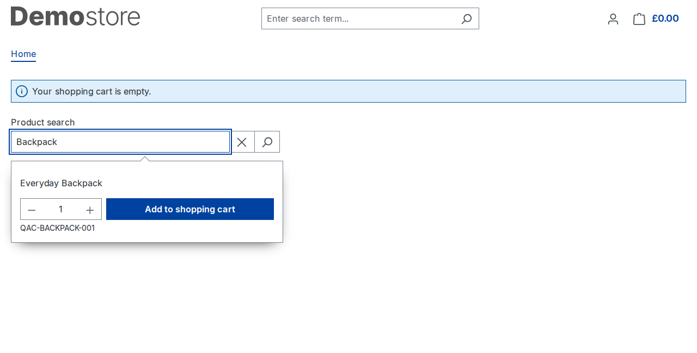
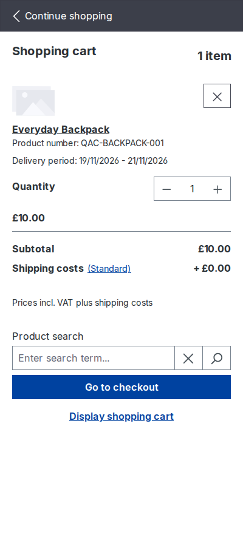
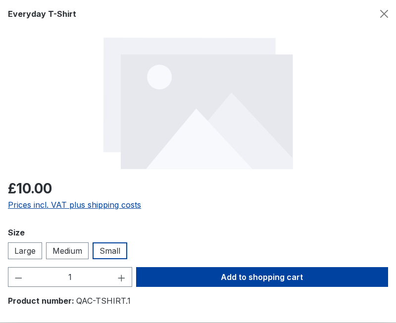

# QuickAddCart

[](https://github.com/CodeRedlich/quick-add-cart/blob/main/composer.json)
[](#requirements)
[](#requirements)
[](https://github.com/CodeRedlich/quick-add-cart/actions/workflows/ci-pipeline.yaml.yml)
[](#testing-and-coverage)
[](#testing-and-coverage)
[](LICENSE.md)

**Add products straight from your cart — by product name or product number.**

QuickAddCart extends the Shopware 6 Storefront with product suggestions and purchase controls on the cart page and in the offcanvas cart. Customers can find another item, choose a quantity and add it to their order without first opening a product detail page. Products with variants open a selection dialog with the Shopware buy widget.

Enable each search location independently, choose compact cart-icon buttons, and control availability with a Shopware Rule Builder rule. English and German storefront snippets and administration configuration labels are included.

[Features](#features) · [Screenshots](#screenshots) · [Installation](#installation) · [Configuration](#configuration) · [Testing](#testing-and-coverage) · [Support](#support-and-contributing)

## Features

- **Search by name or product number.** Suggestions show both the product name and product number, making it easy to identify the right item.
- **Add products from the cart page.** Set the quantity directly in the search result and submit the purchase form to update the cart.
- **Add products from the offcanvas cart.** Search and add simple products while staying on the current storefront page.
- **Choose variants in a dialog.** A **Choose Variant** action opens the product's buy widget, including available variant options and quantity controls.
- **Configure each location separately.** Turn the cart-page search and the offcanvas search on or off independently.
- **Use Rule Builder conditions.** Display the quick-add search only when the selected availability rule matches the current sales-channel context.
- **Choose a compact button style.** Replace the text button in simple-product suggestions with a cart icon that retains an accessible label.
- **Use Shopware's product and cart behavior.** Search suggestions, quantity controls and purchase processing build on the standard Storefront components.

The normal header search continues to work as usual. The additional purchase controls are rendered for the plugin's cart and offcanvas search locations.

## Screenshots

The screenshots below were captured from the running plugin in a local Shopware 6.7 demo storefront with example products. Theme styling, product data, currency and translations depend on your shop.

### Product search on the cart page

Search by product name, check the product number, choose a quantity and add the item directly to the cart.



### Product search in the offcanvas cart

Find another product in the cart sidebar and add it without navigating away from the current page.



### Variant selection

For products with variants, open the selection dialog and use the product's buy widget to choose the desired option.



## Requirements

| Component | Supported version / requirement |
| --- | --- |
| Shopware Core | `~6.7.0` — Shopware 6.7.x |
| Shopware Storefront | `~6.7.0` — Shopware 6.7.x |
| PHP | 8.2.x, 8.3.x, 8.4.x or 8.5.x, subject to the installed Shopware version's own requirements |
| Composer package | `code-redlich/quick-add-cart` |
| Plugin name | `QuickAddCart` |
| License | MIT |

QuickAddCart is a **Shopware Storefront plugin**. A headless frontend needs its own user interface; installing this plugin does not add search controls to an independently implemented frontend.

Node.js is needed when building storefront assets or running the JavaScript test suite. The repository's test tooling requires Node.js 24 or 25; production PHP usage does not require the test tooling.

## Installation

### Install from the repository

Run these commands from your Shopware project root:

```sh
git clone https://github.com/CodeRedlich/quick-add-cart.git custom/plugins/QuickAddCart

php bin/console plugin:refresh
php bin/console plugin:install --activate QuickAddCart

bash bin/build-storefront.sh
php bin/console theme:compile
php bin/console cache:clear
```

Use the storefront build process appropriate to your Shopware deployment if it differs from `bin/build-storefront.sh`.

After installation, open the plugin configuration and enable the search locations you want to use. Activating the plugin alone does not enable the two optional search fields.

### Install with Composer

Once the package is published on Packagist, install it from the Shopware project root:

```sh
composer require code-redlich/quick-add-cart

php bin/console plugin:refresh
php bin/console plugin:install --activate QuickAddCart

bash bin/build-storefront.sh
php bin/console theme:compile
php bin/console cache:clear
```

### Update an existing installation

Update the package or repository checkout using your normal deployment process, then run:

```sh
php bin/console plugin:refresh
php bin/console plugin:update QuickAddCart

bash bin/build-storefront.sh
php bin/console theme:compile
php bin/console cache:clear
```

## Configuration

In the Shopware administration, open **Extensions → My extensions**, find **Quick add to cart**, and open its configuration. Configuration labels are available in English and German. Select the appropriate sales-channel scope before changing settings.

| Setting | Configuration key | Effect |
| --- | --- | --- |
| Show advanced product search in cart | `QuickAddCart.config.showAdvancedSearchInCart` | Shows the product search on the cart page. Disabled while unset. |
| Show advanced product search in off-canvas cart | `QuickAddCart.config.showAdvancedSearchInOffCanvas` | Shows the product search in the offcanvas cart. Disabled while unset. |
| Only Show Cart Icon | `QuickAddCart.config.showOnlyIcon` | Uses an icon-only add button for simple products in search suggestions. The default is the text button. |
| Availability Rule | `QuickAddCart.config.availabilityRule` | Restricts the search widgets to a matching Rule Builder rule. With no rule selected, the enabled locations are available without an additional rule restriction. |

The two visibility switches are independent. For example, you can enable the full cart-page search and keep the standard offcanvas layout.

An availability rule is evaluated against the current sales-channel context. The selected rule must match for either quick-add widget to appear. Rules based on cart values can therefore change the widget's visibility as the cart changes.

### Suggested first setup

1. Enable **Show advanced product search in cart**.
2. Enable **Show advanced product search in off-canvas cart** if you also want sidebar ordering.
3. Leave **Only Show Cart Icon** disabled until you have checked the layout in your theme.
4. Leave **Availability Rule** empty for general availability, or select a rule for your intended audience or cart conditions.
5. Save and check both locations in the storefront.

## How customers use it

1. Open the cart page or the offcanvas cart.
2. Enter a product name or product number in **Product search**.
3. Select the desired quantity for a simple product and click the add-to-cart button.
4. For a product with variants, click **Choose Variant**, select the available options in the dialog, and add the selected variant.

Search uses Shopware's suggestion route and configured minimum search length. Results depend on the current sales channel, its search configuration and product visibility. A simple product receives a direct purchase form only when Shopware considers it available and its calculated maximum purchase quantity meets its minimum purchase quantity.

## Development setup

The included Docker Compose setup uses `dockware/shopware:6.7.15.1` and mounts this repository into `custom/plugins/QuickAddCart`.

```sh
docker compose up -d

docker compose exec shopware php bin/console plugin:refresh
docker compose exec shopware php bin/console plugin:install --activate QuickAddCart

docker compose exec shopware bash bin/build-storefront.sh
docker compose exec shopware php bin/console theme:compile
docker compose exec shopware php bin/console cache:clear
```

If the plugin is already installed, use the update command instead of installing it again. The development storefront is exposed at `http://localhost`; the Compose file also exposes additional Dockware development ports.

## Testing and coverage

The repository includes PHP unit tests, Storefront JavaScript unit tests and browser acceptance tests built with the official [Shopware Acceptance Test Suite](https://developer.shopware.com/docs/guides/development/testing/e2e-playwright/).

| Layer | Tool | Coverage policy |
| --- | --- | --- |
| PHP | PHPUnit with Xdebug | 100% line coverage across PHP sources in `src/`, including executable service and routing configuration |
| Storefront JavaScript | Jest with jsdom | 100% statements, branches, functions and lines across storefront JavaScript sources |
| Storefront behavior | Playwright / Shopware ATS | Browser scenarios against a real Shopware installation; no percentage claim for Twig templates or CSS |

The coverage badges show **enforced thresholds**, not a separate live coverage feed. The CI badge links to the workflow result and changes with GitHub Actions status. Download the coverage artifacts from a workflow run to inspect that run's measured coverage.

### PHP unit tests

From the plugin repository root, use PHP 8.4 and the extensions required by Shopware:

```sh
composer install
composer test:unit
composer test:coverage
```

The coverage command requires Xdebug and fails below 100% line coverage. Reports are written to:

- `build/coverage/clover.xml` — machine-readable PHP coverage.
- `build/coverage/html/index.html` — browsable PHP coverage report.

The unit suite covers availability-rule handling, Twig integration, buy-box controller behavior, unique widget identifiers, exception propagation and service/routing configuration. It uses Composer's autoloader without installing a Shopware database.

### JavaScript unit tests

Use Node.js 24 or 25:

```sh
cd tests/appearence
npm ci
npm run test:unit
npm run typecheck
```

Jest covers plugin registration, event setup and teardown, empty modal-wrapper cleanup, suggestion initialization and compatibility with Shopware's global plugin initializer. Coverage is written to `build/coverage/storefront/` relative to the repository root.

The directory name `tests/appearence/` is retained from the existing repository layout.

### Browser acceptance tests

Use an installed, active plugin with compiled storefront assets in a development or test Shopware instance:

```sh
cd tests/appearence
npm ci
npx playwright install --with-deps chromium

APP_URL=http://localhost/ SHOPWARE_ADMIN_USERNAME=admin SHOPWARE_ADMIN_PASSWORD=shopware npm test
```

`APP_URL` must end with `/`. The credentials above are Dockware development defaults. For integration-based authentication, supply `SHOPWARE_ACCESS_KEY_ID` and `SHOPWARE_SECRET_ACCESS_KEY` instead of administrator credentials.

The acceptance suite creates its own sales channel and test products through the Admin API, restores changed configuration and cleans up its test data. Use a development/test instance for these tests.

Covered scenarios include:

- Search and purchase by product name or product number.
- Empty search results followed by another search.
- Independent cart-page and offcanvas visibility settings.
- Adding a simple product from the offcanvas without leaving the current page.
- Accessible icon-only purchase buttons.
- Matching and non-matching availability rules.
- Opening the variant dialog and adding a selected variant.

Useful commands, run from `tests/appearence/`:

```sh
npm run test:ui
npx playwright test --grep "variant"
npx playwright show-report
```

## Continuous integration and badges

[Shopware Plugin CI](https://github.com/CodeRedlich/quick-add-cart/actions/workflows/ci-pipeline.yaml.yml) runs on pull requests and merge queues targeting `main` or `master`.

The workflow checks the Composer version increment, PHP tests and coverage, JavaScript tests and coverage, TypeScript types, browser acceptance tests and Shopware extension validation against the lowest and highest supported versions. For browser tests it starts a fresh Dockware instance, installs the plugin, builds storefront assets and compiles the theme.

Workflow artifacts include:

| Artifact | Contents |
| --- | --- |
| `php-coverage` | Clover and HTML PHP coverage reports |
| `playwright-results` | Playwright HTML report, JUnit output, JavaScript coverage and failure screenshots, videos and traces |

The version and Shopware badges read the `composer.json` on `main`, so they update when that branch changes. **Version (main)** is the declared development version, rather than a claim that a corresponding release has already been published. The CI badge is scoped to pull-request runs. Coverage gates and the supported PHP range are documented policy badges.

Badge mechanisms follow [GitHub's workflow-badge documentation](https://docs.github.com/en/actions/how-tos/monitor-workflows/add-a-status-badge) and [Shields.io's dynamic JSON documentation](https://shields.io/badges/dynamic-json-badge).

## Troubleshooting

| Symptom | What to check |
| --- | --- |
| No product search is visible | Confirm the plugin is active, enable the corresponding location, check the sales-channel configuration scope, and check whether the availability rule matches. |
| Product suggestions are missing | Enter enough characters to meet Shopware's minimum search length. Check product visibility, searchability and assignment to the active sales channel. |
| A product has no direct add button | Check availability, minimum purchase quantity and calculated maximum purchase quantity. Variant products use **Choose Variant**. |
| Changes to JavaScript or styling do not appear | Rebuild storefront assets, compile the theme and clear Shopware's cache. |
| Search results or a variant dialog look incorrect in a custom theme | Compare against the standard Storefront theme and check overrides of cart, search-suggestion and buy-widget Twig blocks. |
| Playwright cannot reach or authenticate with the shop | Check `APP_URL`, its trailing slash, credentials or integration permissions, and that the target instance is running. |
| PHP coverage cannot be generated | Check that Xdebug is installed and that its coverage mode can be enabled. |

## Support and contributing

Report reproducible problems through [GitHub Issues](https://github.com/CodeRedlich/quick-add-cart/issues). Include your Shopware/PHP versions, theme, relevant plugin settings and steps to reproduce the issue. Screenshots and relevant error messages are helpful.

For contributions, include tests for changed behavior and run the PHP coverage, JavaScript coverage, type checks and relevant browser scenarios before opening a pull request.

Maintained by [CodeRedlich](https://github.com/CodeRedlich). Support: [support@code-redlich.com](mailto:support@code-redlich.com).

## License

QuickAddCart is released under the [MIT License](LICENSE.md).
